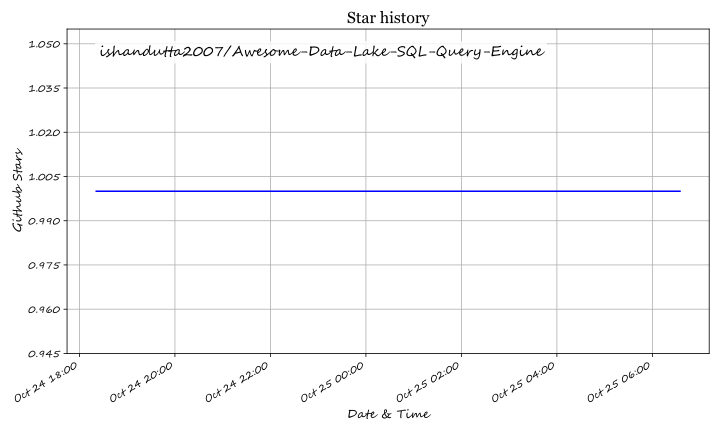

# Awesome-Data-Lake-SQL-Query-Engine
# Awesome-Data-Lake-SQL-Query-Engine

## Top Data Lake SQL Query Engine

**Curated List of SaaS Products & Open-Source GitHub Projects**

*Focused on SQL Query Engines for Data Lakes, Lakehouses, Federated Analytics & Interactive Querying*

**Last updated: October 2026**

This repository tracks notable **SaaS platforms** and **open-source projects** for **Data Lake SQL Query Engines**. These products enable analysts and engineers to run interactive and batch SQL queries directly on data lakes and lakehouses (object storage + open table formats) without always moving data into a traditional warehouse.

**Examples** include Adobe Experience Platform Query Service, Databricks SQL, Snowflake, Google BigQuery, Amazon Athena, Starburst Galaxy, Dremio Cloud, Trino, AWS Redshift Spectrum, and Cloudera Data Warehouse (the category leaders).

**Open-source emphasis**: Data lake query engines have a mature and powerful open-source ecosystem. **Trino**, **Apache Spark SQL**, **Presto**, **DuckDB**, **ClickHouse**, **Apache Impala**, and related projects deliver high-performance, federated, and fully self-hostable SQL analytics. This section is heavily expanded.

Contributions welcome! Open a PR to add/update entries. Keep descriptions factual and link to official sites.

## Table of Contents

- [Sector Overview & Market Dynamics](#sector-overview--market-dynamics)
- [SaaS/Hosted Platforms](#saas-hosted-platforms)
- [Open-Source GitHub Projects](#open-source-github-projects)
- [How to Contribute](#how-to-contribute)
- [Disclaimer](#disclaimer)

## Sector Overview & Market Dynamics

The global data lake and cloud data warehouse market is estimated at **$30B–$38B in 2024–2025**, expanding at a rapid 17%–25% CAGR driven by AI workloads and open table formats (Apache Iceberg, Delta Lake). The market is **moderately to highly concentrated** at the infrastructure layer—where hyperscalers (AWS, Microsoft, Google Cloud) and unified data platforms (Databricks, Snowflake) capture nearly 70% of enterprise spend—yet maintains a vibrant, fragmented open-source and federated query engine ecosystem (Trino, DuckDB, Presto, Dremio) preventing total lock-in.

## SaaS/Hosted Platforms

| Product | Company Valuation / Revenue | Pricing (Starting Tier) | Free Tier / Free Trial Limits | Description |
| :--- | :--- | :--- | :--- | :--- |
| **[Microsoft Fabric / Synapse SQL](https://www.microsoft.com/en-us/microsoft-fabric)** | Microsoft: ~$3.1T Market Cap / ~$245B Ann. Rev. | Starts at ~$0.36/hour (Pay-As-You-Go F2 Capacity SKU with 2 CUs; ~$0.18/CU-hour) | **60-day free trial** with F64 capacity equivalence, 1 TB OneLake storage, subject to standard 24h capacity smoothing/throttling | Unified analytics platform with serverless and dedicated SQL endpoints for querying lakehouse data stored in OneLake. |
| **[Google BigQuery](https://cloud.google.com/bigquery)** | Alphabet: ~$2.1T Market Cap / ~$350B Ann. Rev. | Starts at $6.25 per TB scanned (On-Demand) or compute capacity editions from ~$0.04/slot-hour | **Free tier forever**: 1 TB of query data scanned per month and 10 GB of active storage free; plus $300 credit 90-day GCP trial | Fully serverless, highly scalable data warehouse with BigLake and external table capabilities for querying data lakes on Google Cloud Storage. |
| **[Amazon Athena](https://aws.amazon.com/athena/)** | Amazon / AWS: ~$1.9T Market Cap / ~$105B+ AWS Rev. | Starts at $5.00 per TB of data scanned (serverless per-query model) | **Free tier (AWS Free Tier)**: 1 TB of queries scanned per month for the first 12 months for new AWS accounts | Serverless interactive query service that makes it easy to analyze data in Amazon S3 using standard SQL, with native support for Iceberg, Delta, and Hudi. |
| **[AWS Redshift Spectrum](https://aws.amazon.com/redshift/spectrum/)** | Amazon / AWS: ~$1.9T Market Cap / ~$105B+ AWS Rev. | Starts at $5.00 per TB of data scanned from S3 (plus underlying Redshift cluster costs from ~$0.25/hour for dc2.large) | **Free trial**: 2-month free trial of DC2.large node (750 free hours/month) for eligible Redshift accounts; Spectrum queries billed at $5/TB scanned | Extension of Amazon Redshift that allows querying exabytes of data in S3 without loading it into Redshift clusters. |
| **[Adobe Experience Platform Query Service](https://business.adobe.com/products/experience-platform/query-service.html)** | Adobe: ~$200B Market Cap / ~$21B Ann. Rev. | Enterprise subscription packaging (Data Distiller add-on packaging begins at ~$50,000/year contract tier) | **Proof-of-concept (PoC) only**: No self-service trial; sales-assisted evaluation sandboxes provided under 30-to-60 day evaluation agreements | Serverless SQL interface for querying data stored in Adobe Experience Platform, optimized for customer experience and marketing analytics workloads. |
| **[Snowflake](https://www.snowflake.com/)** | ~$45B Market Cap / ~$3.6B Ann. Rev. | Starts at $2.00 per Snowflake Credit (Standard Edition pay-as-you-go, compute billed per second) | **30-day free trial** with $400 worth of free usage credits across standard compute warehouses | Cloud data platform with excellent support for querying external data lakes and open table formats (including Iceberg) alongside its managed warehouse. |
| **[Databricks SQL](https://www.databricks.com/product/databricks-sql)** | ~$43B Private Valuation / ~$2.4B Ann. Rev. | Starts at $0.22 per DBU (Databricks Unit) on Serverless SQL Starter / $0.07 per DBU for standard jobs | **14-day free trial** with full access to Databricks platform features (cloud provider infrastructure fees apply) | High-performance SQL analytics engine on the Databricks Lakehouse Platform with Photon acceleration, Unity Catalog integration, and strong BI connectivity. |
| **[Cloudera Data Warehouse](https://www.cloudera.com/products/data-warehouse.html)** | ~$5.3B PE Acquisition (CD&R / KKR) / ~$1B+ Rev. | Starts at $0.07 per CCU-hour (Cloudera Compute Unit, metered per minute, plus cloud IaaS costs) | **60-day trial**: Evaluation credits available via Cloudera Public Cloud sales-assisted trial; 60-day private cloud data services trial | Enterprise data warehouse solution with Impala and Hive engines optimized for hybrid and multi-cloud data lake analytics. |
| **[Starburst Galaxy](https://www.starburst.io/platform/starburst-galaxy/)** | ~$3.35B Private Valuation / ~$100M+ ARR | Starts at $0.50 per Starburst credit (Pro Tier); Enterprise starting at $0.75 per credit | **Free tier forever** limited to up to 3 active free clusters; also includes **30-day Enterprise trial with $500 in compute credits** | Fully managed Trino service offering fast, federated SQL across data lakes, warehouses, and operational databases with enterprise governance. |
| **[Dremio Cloud](https://www.dremio.com/)** | ~$2.0B Private Valuation / ~$50M+ ARR | Starts at $0.20 per DCU (Dremio Compute Unit) running pay-as-you-go | **Free tier forever (Standard Edition)**: Up to 10 users, Small engine capacity limit, and ~200 cataloged tables; self-hosted community edition free | Lakehouse platform focused on self-service SQL analytics, semantic layers, and high-performance querying of data lakes and open formats. |

## Open-Source GitHub Projects

- **[Trino](https://github.com/trinodb/trino)**  

  Leading open-source distributed SQL query engine (formerly PrestoSQL). Excellent for interactive, federated queries across data lakes, warehouses, and many other sources. Apache 2.0.

- **[Apache Spark SQL](https://github.com/apache/spark)**  

  Powerful SQL interface on top of Apache Spark. Ideal for large-scale batch analytics, ETL, and machine learning pipelines on data lakes and lakehouses.

- **[Presto](https://github.com/prestodb/presto)**  

  Original distributed SQL query engine designed for interactive analytics on large datasets. Still actively maintained under the Presto Foundation / Linux Foundation.

- **[DuckDB](https://github.com/duckdb/duckdb)**  

  In-process analytical SQL database optimized for local and embedded analytics. Extremely fast for querying Parquet, Iceberg, and other lake formats on a single machine.

- **[ClickHouse](https://github.com/ClickHouse/ClickHouse)**  

  High-performance open-source columnar OLAP database that can efficiently query data lakes and is widely used for real-time and large-scale analytics.

- **[Apache Impala](https://github.com/apache/impala)**  

  Native massively parallel processing (MPP) SQL engine designed for high-performance queries on Hadoop and cloud data lakes.

- **[Apache Hive](https://github.com/apache/hive)**  

  Classic data warehouse infrastructure built on Hadoop. Provides SQL-like querying (HiveQL) and remains foundational in many data lake environments.

- **[Apache Drill](https://github.com/apache/drill)**  

  Schema-free SQL query engine that can query a wide variety of data sources and formats, including nested data in data lakes.

- **[StarRocks](https://github.com/StarRocks/starrocks)**  

  High-performance open-source MPP analytical database with strong data lake querying capabilities and real-time analytics features.

- **[Apache Doris](https://github.com/apache/doris)**  

  Easy-to-use, high-performance, real-time analytical database that supports efficient querying of data lake formats.

### Additional Strong Open-Source Options

- Federated / interactive SQL: **Trino**, **Presto**.

- Large-scale processing + SQL: **Apache Spark SQL**.

- Lightweight / local analytics: **DuckDB**.

- High-performance OLAP: **ClickHouse**, **StarRocks**, **Apache Doris**, **Apache Impala**.

- Classic lake SQL: **Apache Hive**.

- Supporting technologies: Apache Iceberg, Delta Lake, Apache Hudi (table formats), Kyuubi (Spark SQL gateway).

- Accepting that commercial platforms (Databricks SQL, Snowflake, BigQuery, Athena, Starburst Galaxy, Dremio) still lead in managed infrastructure, governance, performance optimizations (e.g., Photon), and enterprise support.

**Frameworks for building custom systems**:  

Deploy **Trino** or **Presto** for interactive federated SQL → use **Apache Spark SQL** for heavy batch and ML workloads → add **DuckDB** for local development and lightweight analytics → store data in open formats (**Iceberg**, **Delta Lake**, or **Hudi**) on object storage. Ideal for organizations that want full control, avoid vendor lock-in, and can operate the infrastructure themselves.

## How to Contribute

1. Fork the repo.

2. Add/edit entries in `README.md` (follow existing format).

3. Include: name, link, 1–2 sentence description, and whether it's SaaS or open-source.

4. Submit PR with a short explanation.

Star the repo if you find it useful!

## Disclaimer

- This is a **community-curated** list — not exhaustive and not an endorsement.

- Data lake query engines interact with large volumes of potentially sensitive data. Carefully evaluate security, access control, cost management, and operational requirements. Self-hosted open-source engines provide maximum flexibility but require engineering ownership. This list is not architectural or security advice.

---

**Made for data engineers, analytics engineers, platform teams, and open-source advocates.**

Let's keep data lake analytics fast, open, and under your control.

## ⭐ Star History

<a href="https://star-history.com/#ishandutta2007/Awesome-Data-Lake-SQL-Query-Engine&Timeline" align="center">
  <picture>
    <source media="(prefers-color-scheme: dark)" srcset="assets/ishandutta2007_Awesome-Data-Lake-SQL-Query-Engine_growth.svg">
    
  </picture>
</a>
