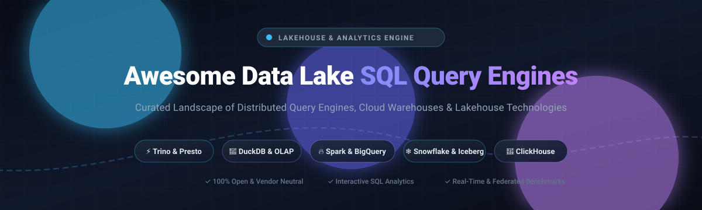

  

  
  
  
  
  
  
  

# 🚀 Awesome Data Lake SQL Query Engines

> 🌟 **A Curated Directory of Distributed SQL Engines, Lakehouse Platforms, Cloud Data Warehouses, and Federated Analytics Architectures**

**Last updated: October 2026** 📅

This open-source catalog explores state-of-the-art **SaaS platforms** and **open-source SQL query engines** purpose-built for data lakes, lakehouses (Apache Iceberg, Delta Lake, Apache Hudi), and federated analytics. These technologies empower data engineers, platform architects, and analysts to run blazing-fast interactive and batch SQL queries directly against distributed object storage (Amazon S3, Google Cloud Storage, Azure Data Lake Storage / OneLake, MinIO) without redundant ETL or data warehouse lock-in.

---

## 📑 Table of Contents

- [📊 Sector Overview & Market Dynamics](#-sector-overview--market-dynamics)
- [☁️ SaaS & Hosted Platforms](#️-saas--hosted-platforms)
- [⚡ Open-Source GitHub Projects](#-open-source-github-projects)
- [🛠️ Architectural Guidance & Stack Selection](#️-architectural-guidance--stack-selection)
- [🤝 How to Contribute](#-how-to-contribute)
- [💖 Support & Sponsorship](#-support--sponsorship)
- [⭐ Star History](#-star-history)
- [📜 Disclaimer](#-disclaimer)

---

## 📊 Sector Overview & Market Dynamics

The global data lake and cloud data warehouse market is estimated at **$30B–$38B in 2024–2025**, expanding at a rapid 17%–25% CAGR driven by generative AI workloads, vector extensions, and open table formats (Apache Iceberg, Delta Lake). 

The market is **moderately to highly concentrated** at the infrastructure layer—where cloud hyperscalers (AWS, Microsoft Azure, Google Cloud) and unified commercial platforms (Databricks, Snowflake) capture nearly 70% of enterprise analytics budgets. Conversely, the query layer maintains a vibrant, fragmented open-source ecosystem (Trino, DuckDB, Presto, DataFusion, ClickHouse) that empowers organizations to prevent proprietary vendor lock-in and decouple compute from storage.

---

## ☁️ SaaS & Hosted Platforms

Enterprise-grade managed query engines, serverless lakehouse SQL platforms, and cloud data warehouses sorted by company valuation/revenue:

| Product | 🏢 Valuation / Revenue | 💰 Pricing (Starting Tier) | 🎁 Free Tier / Free Trial Limits | 📝 Description |
| :--- | :--- | :--- | :--- | :--- |
| **[Microsoft Fabric / Synapse SQL](https://www.microsoft.com/en-us/microsoft-fabric)** | Microsoft: ~$3.1T Market Cap / ~$245B Ann. Rev. | Starts at ~$0.36/hour (Pay-As-You-Go F2 Capacity SKU with 2 CUs; ~$0.18/CU-hour) | **60-day free trial** with F64 capacity equivalence, 1 TB OneLake storage, subject to standard 24h capacity smoothing/throttling | Unified analytics platform with serverless and dedicated SQL endpoints for querying lakehouse data stored in OneLake. |
| **[Google BigQuery](https://cloud.google.com/bigquery)** | Alphabet: ~$2.1T Market Cap / ~$350B Ann. Rev. | Starts at $6.25 per TB scanned (On-Demand) or compute capacity editions from ~$0.04/slot-hour | **Free tier forever**: 1 TB of query data scanned per month and 10 GB of active storage free; plus $300 credit 90-day GCP trial | Fully serverless, highly scalable data warehouse with BigLake and external table capabilities for querying data lakes on Google Cloud Storage. |
| **[Amazon Athena](https://aws.amazon.com/athena/)** | Amazon / AWS: ~$1.9T Market Cap / ~$105B+ AWS Rev. | Starts at $5.00 per TB of data scanned (serverless per-query model) | **Free tier (AWS Free Tier)**: 1 TB of queries scanned per month for the first 12 months for new AWS accounts | Serverless interactive query service that makes it easy to analyze data in Amazon S3 using standard SQL, with native support for Iceberg, Delta, and Hudi. |
| **[AWS Redshift Spectrum](https://aws.amazon.com/redshift/spectrum/)** | Amazon / AWS: ~$1.9T Market Cap / ~$105B+ AWS Rev. | Starts at $5.00 per TB of data scanned from S3 (plus underlying Redshift cluster costs from ~$0.25/hour for dc2.large) | **Free trial**: 2-month free trial of DC2.large node (750 free hours/month) for eligible Redshift accounts; Spectrum queries billed at $5/TB scanned | Extension of Amazon Redshift that allows querying exabytes of data in S3 without loading it into Redshift clusters. |
| **[Adobe Experience Platform Query Service](https://business.adobe.com/products/experience-platform/query-service.html)** | Adobe: ~$200B Market Cap / ~$21B Ann. Rev. | Enterprise subscription packaging (Data Distiller add-on packaging begins at ~$50,000/year contract tier) | **Proof-of-concept (PoC) only**: No self-service trial; sales-assisted evaluation sandboxes provided under 30-to-60 day evaluation agreements | Serverless SQL interface for querying data stored in Adobe Experience Platform, optimized for customer experience and marketing analytics workloads. |
| **[Snowflake](https://www.snowflake.com/)** | ~$45B Market Cap / ~$3.6B Ann. Rev. | Starts at $2.00 per Snowflake Credit (Standard Edition pay-as-you-go, compute billed per second) | **30-day free trial** with $400 worth of free usage credits across standard compute warehouses | Cloud data platform with excellent support for querying external data lakes and open table formats (including Iceberg) alongside its managed warehouse. |
| **[Databricks SQL](https://www.databricks.com/product/databricks-sql)** | ~$43B Private Valuation / ~$2.4B Ann. Rev. | Starts at $0.22 per DBU (Databricks Unit) on Serverless SQL Starter / $0.07 per DBU for standard jobs | **14-day free trial** with full access to Databricks platform features (cloud provider infrastructure fees apply) | High-performance SQL analytics engine on the Databricks Lakehouse Platform with Photon acceleration, Unity Catalog integration, and strong BI connectivity. |
| **[Cloudera Data Warehouse](https://www.cloudera.com/products/data-warehouse.html)** | ~$5.3B PE Acquisition (CD&R / KKR) / ~$1B+ Rev. | Starts at $0.07 per CCU-hour (Cloudera Compute Unit, metered per minute, plus cloud IaaS costs) | **60-day trial**: Evaluation credits available via Cloudera Public Cloud sales-assisted trial; 60-day private cloud data services trial | Enterprise data warehouse solution with Impala and Hive engines optimized for hybrid and multi-cloud data lake analytics. |
| **[Starburst Galaxy](https://www.starburst.io/platform/starburst-galaxy/)** | ~$3.35B Private Valuation / ~$100M+ ARR | Starts at $0.50 per Starburst credit (Pro Tier); Enterprise starting at $0.75 per credit | **Free tier forever** limited to up to 3 active free clusters; also includes **30-day Enterprise trial with $500 in compute credits** | Fully managed Trino service offering fast, federated SQL across data lakes, warehouses, and operational databases with enterprise governance. |
| **[Dremio Cloud](https://www.dremio.com/)** | ~$2.0B Private Valuation / ~$50M+ ARR | Starts at $0.20 per DCU (Dremio Compute Unit) running pay-as-you-go | **Free tier forever (Standard Edition)**: Up to 10 users, Small engine capacity limit, and ~200 cataloged tables; self-hosted community edition free | Lakehouse platform focused on self-service SQL analytics, semantic layers, and high-performance querying of data lakes and open formats. |

---

## ⚡ Open-Source GitHub Projects

Leading open-source distributed SQL query engines, MPP columnar databases, and analytical runtimes for data lakes and lakehouses, sorted by GitHub stargazers:

1. **[ClickHouse](https://github.com/ClickHouse/ClickHouse)**   
   High-performance open-source columnar OLAP database management system that allows real-time analytical reporting using SQL, featuring native support for reading and writing Parquet, Iceberg, and S3 data lakes.

2. **[Apache Spark SQL](https://github.com/apache/spark)**   
   Unified engine for large-scale distributed data processing and ETL. Spark SQL provides cost-based optimization (Catalyst), code generation (Tungsten), and native connectors for Delta Lake, Iceberg, and Hudi.

3. **[DuckDB](https://github.com/duckdb/duckdb)**   
   In-process analytical SQL database management system (the "SQLite for Analytics"). Ultra-fast vectorized query execution engine designed for local analytics, embedded pipelines, and querying remote Parquet and Iceberg files.

4. **[Presto](https://github.com/prestodb/presto)**   
   The original open-source distributed SQL query engine developed at Meta, maintained by the Presto Foundation under the Linux Foundation. Built for interactive analytical queries against petabyte-scale data lakes.

5. **[Apache Doris](https://github.com/apache/doris)**   
   High-performance, real-time analytical database based on MPP architecture. Provides sub-second queries, materialized views, vector search, and seamless external querying of Hive, Iceberg, and Hudi tables.

6. **[Trino](https://github.com/trinodb/trino)**   
   Fast distributed SQL query engine for big data analytics (formerly PrestoSQL). Renowned for federated SQL across heterogeneous data sources, object stores, and modern lakehouse formats (Iceberg, Delta Lake).

7. **[StarRocks](https://github.com/StarRocks/starrocks)**   
   Next-generation sub-second MPP analytical engine with a fully vectorized execution core and cost-based optimizer, delivering high-speed data lake analytics and real-time materialized views directly on open formats.

8. **[Apache DataFusion](https://github.com/apache/datafusion)**   
   Extensible, blazingly fast in-memory query engine written in Rust using Apache Arrow format. Widely used as the foundational modular engine for building custom distributed SQL and data lake platforms.

9. **[Apache Hive](https://github.com/apache/hive)**   
   Foundational distributed data warehouse software built on Hadoop. Provided the original Hive Metastore (HMS) metadata abstraction standard that underpins modern data lake table catalogs worldwide.

10. **[Apache Calcite](https://github.com/apache/calcite)**   
    Dynamic data management and SQL query optimization framework. Powers SQL parsing, planning, validation, and cost-based optimization across leading engines like Drill, Hive, BlazingSQL, and Flink.

11. **[Apache Kyuubi](https://github.com/apache/kyuubi)**   
    Distributed multi-tenant gateway for enterprise data lake query engines (Spark SQL, Trino, Flink). Provides standard JDBC/ODBC endpoints, authentication, queuing, and cluster isolation.

12. **[Apache Drill](https://github.com/apache/drill)**   
    Schema-free SQL query engine designed for agile exploration of unstructured and semi-structured big data across NoSQL databases, file systems, and cloud object storage without schema definitions.

13. **[Dremio Community Edition (OSS)](https://github.com/dremio/dremio-oss)**   
    Open-source core of Dremio's SQL lakehouse engine powered by Apache Arrow Flight and Gandiva. Provides lightning-fast BI queries and a unified semantic layer directly over data lake object storage.

14. **[Apache Impala](https://github.com/apache/impala)**   
    Lightning-fast massively parallel processing (MPP) SQL query engine built natively in C++ for Apache Hadoop and cloud storage, delivering low latency for interactive business intelligence workloads.

---

## 🛠️ Architectural Guidance & Stack Selection

- **Federated / Interactive SQL**: Deploy **Trino** or **Presto** when you need a single ANSI SQL gateway connecting to S3, Snowflake, PostgreSQL, Kafka, and Hive Metastore.
- **Large-Scale Batch Processing & ETL**: Rely on **Apache Spark SQL** for complex multi-stage batch transforms, data preparation, and distributed ML pipelines.
- **Embedded & Single-Node Analytics**: Leverage **DuckDB** or **Apache DataFusion** for serverless, local CLI tools, PyData dataframes, and sub-second querying of Parquet files without cluster operational overhead.
- **Sub-Second OLAP & High-Concurrency BI**: Use **ClickHouse**, **StarRocks**, or **Apache Doris** for low-latency ad-hoc slicing and dicing with pre-aggregated or columnar indexes.
- **Multi-Engine Gateway & JDBC/ODBC Management**: Implement **Apache Kyuubi** to offer serverless enterprise SQL gateways to end users.
- **Open Table Formats**: Pair your query engine with open standards like **Apache Iceberg**, **Delta Lake**, or **Apache Hudi** to guarantee ACID transactions, partition evolution, and time-travel querying.

---

## 🤝 How to Contribute

Contributions are warmly welcomed! Help us keep this directory comprehensive and up-to-date:

1. 🍴 Fork the repository.
2. 🌿 Create a feature branch (`git checkout -b add-query-engine`).
3. ✏️ Add or update entries following the formatting standard (include official documentation, GitHub repo, pricing/stars, and clear architecture details).
4. 🚀 Submit a Pull Request with a descriptive summary of your changes.

---

## 💖 Support & Sponsorship

If you find this repository valuable for your data engineering workflows, research, or architecture design, please consider supporting the project:

- ⭐ **Star this repository** to improve discoverability for other developers.
- 🍴 **Fork and share** with colleagues and data teams.
- ☕ **Sponsor or buy a coffee** via the [GitHub Sponsor Dashboard](https://github.com/sponsors/ishandutta2007) to help sustain maintenance and updates!

---

## ⭐ Star History

---

## 📜 Disclaimer

- This is an independent, community-curated list maintained for educational and architectural reference purposes.
- Product logos, trademarks, and registered marks belong to their respective owners.
- Data lake query engines interact with large volumes of potentially sensitive production data. Carefully evaluate security, access control, multi-cloud egress costs, and operational overhead before deploying any platform in production.
